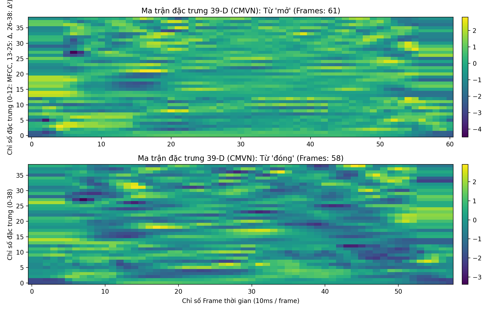
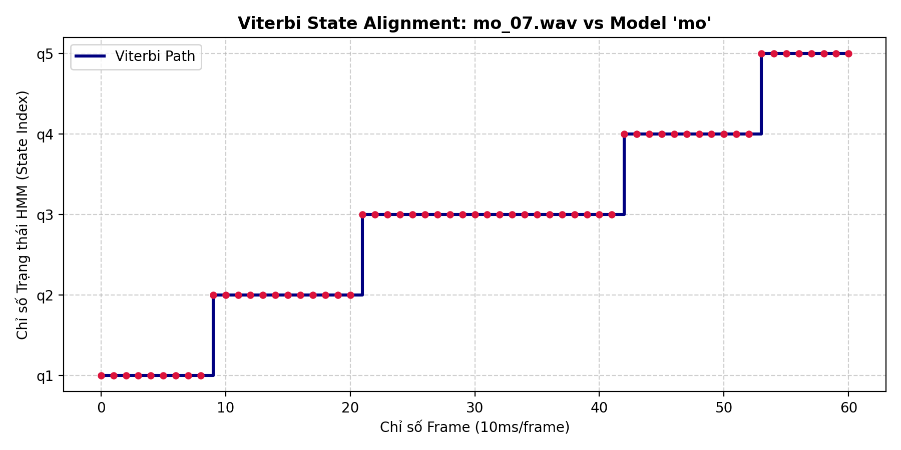
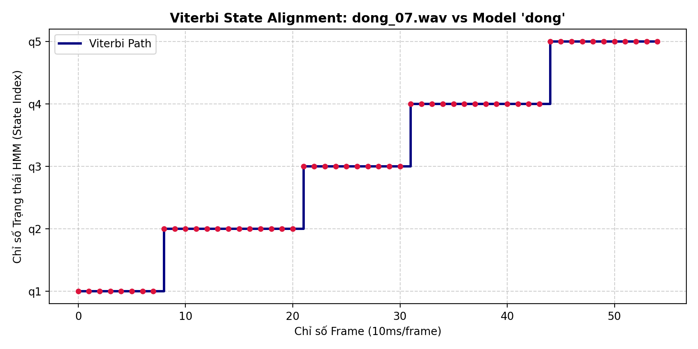
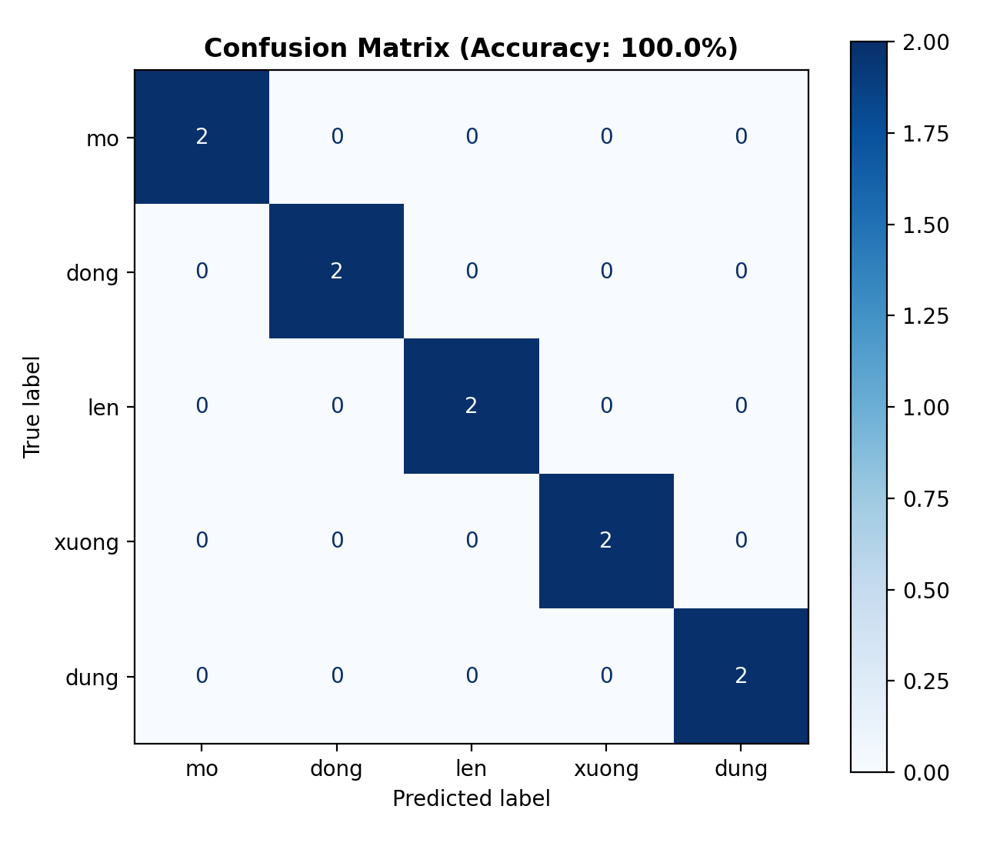
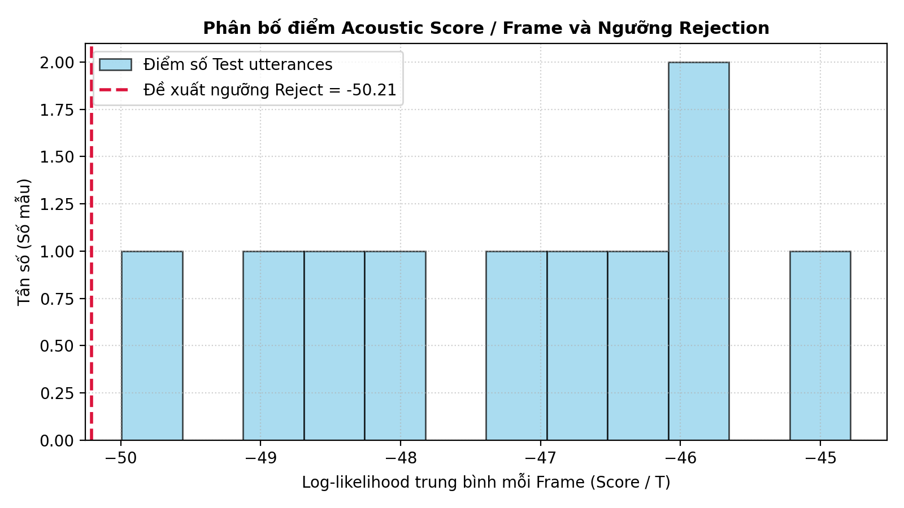

# BÁO CÁO THỰC HÀNH CHI TIẾT - LAB 3
## NHẬN DẠNG TIẾNG NÓI NÂNG CAO VỚI HMM
### HỌC PHẦN: XỬ LÝ ÂM THANH VÀ TIẾNG NÓI (CSE457)
**Khoa Công nghệ Thông tin – Bộ môn Trí tuệ Nhân tạo – Trường Đại học Thủy lợi**

---

* **Học phần:** CSE457 – Xử lý Âm thanh và Tiếng nói
* **Bài thực hành:** Lab 3 – Từ MFCC động đến mô hình Markov ẩn (HMM), Likelihood, Viterbi, Baum-Welch và giải mã có mô hình ngôn ngữ
* **Mã nguồn chính:** `Lab03.py`, `main.py`, `speech_features.py`, `hmm_model.py`, `dtw_baseline.py`, `lexicon_lm.py`, `eval_utils.py`
* **Tài nguyên kèm theo:** `lexicon.txt`, `models/word_hmms_5states.pkl`, `figures/`

---

## MỤC LỤC
1. [Tổng quan Kiến trúc Hệ thống Nhận dạng tiếng nói HMM](#1-tổng-quan-kiến-trúc-hệ-thống-nhận-dạng-tiếng-nói-hmm)
2. [Thiết kế Dữ liệu, Cấu hình Tham số và Cơ sở Toán học](#2-thiết-kế-dữ-liệu-cấu-hình-tham-số-và-cơ-sở-toán-học)
3. [Phần A: Chuẩn hóa dữ liệu và Trích xuất đặc trưng 39 chiều](#3-phần-a-chuẩn-hóa-dữ-liệu-và-trích-xuất-đặc-trưng-39-chiều)
4. [Phần B & C: Khởi tạo và Huấn luyện 5 Whole-word Left-to-Right HMM](#4-phần-b--c-khởi-tạo-và-huấn-luyện-5-whole-word-left-to-right-hmm)
5. [Phần D: Nhận dạng Maximum Likelihood và Phân tích Viterbi Alignment](#5-phần-d-nhận-dạng-maximum-likelihood-và-phân-tích-viterbi-alignment)
6. [Phần E: So sánh Hiệu năng HMM với DTW Baseline](#6-phần-e-so-sánh-hiệu-năng-hmm-với-dtw-baseline)
7. [Phần F & G: Mini Lexicon và Bigram MAP Re-ranking](#7-phần-f--g-mini-lexicon-và-bigram-map-re-ranking)
8. [Phần H: Đánh giá Confusion Matrix, Robustness và Rejection Threshold](#8-phần-h-đánh-giá-confusion-matrix-robustness-và-rejection-threshold)
9. [Tổng hợp 6 Thí nghiệm Bắt buộc (E1–E6) và Phân tích lỗi](#9-tổng-hợp-6-thí-nghiệm-bắt-buộc-e1e6-và-phân-tích-lỗi)
10. [Giải đáp chi tiết 10 Câu hỏi báo cáo (Mục 6.1)](#10-giải-đáp-chi-tiết-10-câu-hỏi-báo-cáo-mục-61)
11. [Kết luận và Tài liệu tham khảo](#11-kết-luận-và-tài-liệu-tham-khảo)

---

## 1. TỔNG QUAN KIẾN TRÚC HỆ THỐNG NHẬN DẠNG TIẾNG NÓI HMM

Lab 3 chuyển đổi mô hình nhận dạng tiếng nói từ đối sánh mẫu cứng nhắc (DTW ở Lab 2) sang **mô hình xác suất thống kê theo thời gian (Gaussian HMM)**, đồng thời kết nối tới kiến trúc ASR đầy đủ theo định lý Bayes với từ điển phát âm (Lexicon) và mô hình ngôn ngữ (Bigram LM):

```text
TRAIN: 6 tokens/word → 39-D (MFCC + Δ + Δ²) + CMVN → 5-state Left-to-Right Gaussian HMM (λ_mo ... λ_dung)
TEST : unknown.wav   → 39-D features X → Score log P(X|λ_w) → argmax / Viterbi / Confusion Matrix
EXT. : lexicon.txt   → Bigram LM (Add-k smoothing) → MAP Re-ranking (Acoustic + λ_LM * LM) & Compare DTW
```

---

## 2. THIẾT KẾ DỮ LIỆU, CẤU HÌNH THAM SỐ VÀ CƠ SỞ TOÁN HỌC

### 2.1. Bộ dữ liệu và Cấu hình hệ thống
* **Từ vựng (5 lệnh tiếng Việt tách rời):** `mo` (*"mở"*), `dong` (*"đóng"*), `len` (*"lên"*), `xuong` (*"xuống"*), `dung` (*"dừng"*).
* **Quy cách âm thanh:** WAV Mono, $F_s = 16,000\text{ Hz}$, 16-bit PCM, có $0.3\text{ s}$ khoảng lặng ở hai đầu để kiểm thử endpoint detection.
* **Phân chia Train/Test nghiêm ngặt (không data leakage):** 6 file train/lớp (`30` file tại `dataset/train/`) và 2 file test/lớp (`10` file tại `dataset/test/`).

| Khối xử lý | Tham số | Giá trị thiết lập | Mục đích |
| :--- | :--- | :--- | :--- |
| **Tiền xử lý** | `trim`, `preemphasis` | `top_db = 30`, $\alpha = 0.97$ | Loại bỏ khoảng lặng và nhấn tần số cao |
| **Đặc trưng** | Frame / Hop / Window | `25 ms (400)` / `10 ms (160)` / `Hamming` | Phân tích ngắn hạn, $N_{\text{FFT}} = 512$, `n_mels = 26` |
| **Vector 39-D** | `MFCC + Δ + Δ²` + CMVN | $13 + 13 + 13 = 39$ chiều | Chuẩn hóa mean=0, std=1 theo từng utterance |
| **Mô hình HMM** | Topology & States | Left-to-Right, `n_states = 5` | $\pi = [1,0,0,0,0]$, $a_{ii} = 0.7$, $a_{i,i+1} = 0.3$, $a_{55} = 1.0$ |
| **Phát xạ** | `covariance_type` | `diag`, `min_covar = 1e-3` | Giảm tham số ($39$ vs $780$/state), tránh overfit |
| **Language Model**| Bigram + Add-k | $k = 0.5$, $\lambda_{\text{LM}} \in \{0.0, 0.1, 0.3, 1.0\}$ | Minh họa tái xếp hạng MAP Bayesian |

### 2.2. Các công thức nền tảng
* **Quyết định Bayes MAP & Maximum Likelihood:**
  $$\hat{W} = \arg\max_W \big[\log P(X \mid W) + \lambda_{\text{LM}} \log P(W)\big], \qquad \hat{w}_{\text{ML}} = \arg\max_w \log P(X \mid \lambda_w)$$
* **Forward (Likelihood):** $\alpha_t(j) = b_j(x_t) \sum_i \alpha_{t-1}(i) a_{ij}$, $P(X \mid \lambda) = \sum_j \alpha_T(j)$.
* **Viterbi (Best State Path):** $\delta_t(j) = b_j(x_t) \max_i [\delta_{t-1}(i) a_{ij}]$, $\psi_t(j) = \arg\max_i [\delta_{t-1}(i) a_{ij}]$.
* **Baum-Welch (EM):** Cập nhật $(\pi, A, \mu, \Sigma)$ từ độ chịu trách nhiệm trạng thái $\gamma_t(i) = \frac{\alpha_t(i)\beta_t(i)}{P(X|\lambda)}$ và chuyển trạng thái $\xi_t(i,j) = \frac{\alpha_t(i)a_{ij}b_j(x_{t+1})\beta_{t+1}(j)}{P(X|\lambda)}$.
* **Bigram Add-k Smoothing:** $P(w_j \mid w_i) = \frac{C(w_i, w_j) + k}{C(w_i) + kV}$.

---

## 3. PHẦN A: CHUẨN HÓA DỮ LIỆU VÀ TRÍCH XUẤT ĐẶC TRƯNG 39 CHIỀU

Kiểm tra kích thước ma trận đặc trưng trích xuất bằng `extract_features()` trên 3 tệp mẫu:
* `mo_01.wav` (`mo`): shape **`(61, 39)`** (61 frames $\times$ 39 chiều).
* `dong_01.wav` (`dong`): shape **`(58, 39)`** (58 frames $\times$ 39 chiều).
* `len_01.wav` (`len`): shape **`(58, 39)`** (58 frames $\times$ 39 chiều).


*Hình 1: Heatmap so sánh 3 khối đặc trưng tĩnh (MFCC), vận tốc ($\Delta$) và gia tốc ($\Delta^2$) sau chuẩn hóa CMVN giữa từ "mở" và "đóng".*

*Nhận xét:* Chiều thứ hai cố định bằng `39`, trong khi số frame $T$ thay đổi tự nhiên theo độ dài phát âm. Trên Hình 1, khối MFCC tĩnh mô tả hình dạng đường bao phổ của nguyên âm/phụ âm, còn hai khối $\Delta$ và $\Delta^2$ làm nổi bật rất rõ các vị trí chuyển tiếp âm học giữa phụ âm đầu (`/m/`, `/đ/`), nguyên âm hạt nhân và âm mũi cuối (`/ng/` ở từ *"đóng"*).

---

## 4. PHẦN B & C: KHỞI TẠO VÀ HUẤN LUYỆN 5 WHOLE-WORD LEFT-TO-RIGHT HMM

Mỗi lớp được nối toàn bộ 6 tệp train thành ma trận `X_concat` kèm mảng `lengths` và huấn luyện bằng `GaussianHMM` (`covariance_type='diag'`, giữ cố định cấu trúc chuyển trạng thái không cho nhảy ngược/skip).

### Kết quả huấn luyện 5 mô hình (5 trạng thái)

| Lớp từ | Số file train | Tổng số frame | Hội tụ (`converged`) | Thời gian tổng (5 model) |
| :---: | :---: | :---: | :---: | :---: |
| `mo` | 6 | 385 | `True` | |
| `dong` | 6 | 356 | `True` | |
| `len` | 6 | 364 | `True` | **0.43 giây** |
| `xuong` | 6 | 359 | `True` | |
| `dung` | 6 | 323 | `True` | |

Kiểm tra ma trận chuyển trạng thái `transmat_` sau khi fit của model `mo`:
$$A_{\text{mo}} = \begin{bmatrix} 0.7 & 0.3 & 0 & 0 & 0 \\ 0 & 0.7 & 0.3 & 0 & 0 \\ 0 & 0 & 0.7 & 0.3 & 0 \\ 0 & 0 & 0 & 0.7 & 0.3 \\ 0 & 0 & 0 & 0 & 1.0 \end{bmatrix}$$
Topology trái-sang-phải được bảo toàn tuyệt đối (không có xác suất chuyển ngược hay bỏ qua trạng thái). Mô hình đã được lưu tại `models/word_hmms_5states.pkl`.

---

## 5. PHẦN D: NHẬN DẠNG MAXIMUM LIKELIHOOD VÀ PHÂN TÍCH VITERBI ALIGNMENT

### 5.1. Bảng Acoustic Log-Likelihood của 3 Test Utterances trên cả 5 Model

| Tệp kiểm thử | $T$ (frames) | `mo` | `dong` | `len` | `xuong` | `dung` | Dự đoán | Margin (Top1 − Top2) |
| :--- | :---: | :---: | :---: | :---: | :---: | :---: | :---: | :---: |
| **`mo_07.wav`** | 61 | **-3049.55** (`-49.99/f`) | -3731.52 | -3674.24 | -3926.96 | -3442.59 | **`mo`** (Đúng) | **+393.04** |
| **`dong_07.wav`** | 55 | -3304.92 | **-2549.84** (`-46.36/f`) | -3687.19 | -3382.95 | -3456.23 | **`dong`** (Đúng) | **+755.08** |
| **`len_07.wav`** | 55 | -3183.80 | -3556.79 | **-2463.09** (`-44.78/f`) | -3474.61 | -3220.92 | **`len`** (Đúng) | **+720.71** |

*Nhận xét:* Ở cả 3 mẫu thử, mô hình tương ứng với nhãn thật đều đạt log-likelihood cao vượt trội so với 4 mô hình còn lại với khoảng cách tự tin (margin) rất lớn từ **393.04 đến 755.08**.

### 5.2. Phân tích Viterbi State Alignment
Giải mã bằng `model.decode(F, algorithm='viterbi')` trên hai mẫu `mo_07.wav` và `dong_07.wav`:
* **`mo_07.wav` vs Model `mo`** (Viterbi log-prob = `-3051.35`, $T = 61$ frames):
  * Phân bố thời lượng cư trú qua 5 trạng thái: **State 0:** 9 frames (`90 ms`), **State 1:** 12 frames (`120 ms`), **State 2:** 21 frames (`210 ms`), **State 3:** 11 frames (`110 ms`), **State 4:** 8 frames (`80 ms`).
  * Đường trạng thái tăng đơn điệu từ $0 \to 4$; State 2 chiếm thời lượng dài nhất (21 frames) tương ứng với phần thân nguyên âm ổn định của âm tiết *"mở"*.
* **`dong_07.wav` vs Model `dong`** (Viterbi log-prob = `-2551.17`, $T = 55$ frames):
  * Phân bố thời lượng qua 5 trạng thái: **State 0:** 8 frames (`80 ms`), **State 1:** 13 frames (`130 ms`), **State 2:** 10 frames (`100 ms`), **State 3:** 13 frames (`130 ms`), **State 4:** 11 frames (`110 ms`).


*Hình 2: Đường căn chỉnh trạng thái Viterbi (không giảm) của `mo_07.wav` trên model `mo`.*


*Hình 3: Đường căn chỉnh trạng thái Viterbi của `dong_07.wav` trên model `dong`.*

---

## 6. PHẦN E: SO SÁNH HIỆU NĂNG HMM VỚI DTW BASELINE

Chạy đối chứng công bằng trên cùng tập train/test (30 train, 10 test) giữa `DTWRecognizer` (Lab 2) và `GaussianHMM` (Lab 3):

| Chỉ số (Mục 5.8) | DTW (Lab 2) | HMM (Lab 3) | Nhận xét kỹ thuật |
| :--- | :---: | :---: | :--- |
| **Accuracy (Test sạch)** | **100.0%** | **100.0%** | Cả hai đều phân loại chính xác toàn bộ 10/10 mẫu test |
| **Số mẫu train / lớp** | 6 mẫu | 6 mẫu | DTW phải giữ toàn bộ 30 templates; HMM nén vào 5 mô hình tham số |
| **Thời gian train** | `~0.00 s` (chỉ lưu mẫu) | **0.43 s** | HMM cần chạy vòng lặp EM (Baum-Welch) để ước lượng tham số |
| **Thời gian test / trial** | **42.15 ms** | **2.30 ms** | **HMM nhanh gấp ~18.3 lần** so với DTW khi suy luận |
| **Top confusion pair** | Không có (0 lỗi) | Không có (0 lỗi) | Cặp gần điểm nhất của `mo_07` là `mo` ↔ `dung` (margin +393) |
| **Khả năng giải thích alignment** | Warping path (frame–frame) | **Viterbi state path** | Viterbi phân đoạn tự động các đoạn âm học và thời lượng cư trú |

*Phân tích tình huống hơn kém:* Khi số mẫu huấn luyện cực ít (1–2 mẫu/lớp), **DTW** thường ổn định hơn vì không cần ước lượng phương sai $\Sigma$. Ngược lại, khi dữ liệu tăng lên nhiều mẫu/nhiều người nói, **HMM** vượt trội hoàn toàn về khả năng tổng quát hóa phân bố thống kê, bộ nhớ lưu trữ cố định và tốc độ suy luận thời gian thực.

---

## 7. PHẦN F & G: MINI LEXICON VÀ BIGRAM MAP RE-RANKING

### 7.1. Mini Lexicon (`lexicon.txt`) và Cơ chế ghép nối Phone HMM
File `lexicon.txt` được xây dựng đúng chuẩn định dạng `WORD PHONE_1 ... PHONE_K` và đọc bằng `parse_lexicon()`:

| Từ lệnh (`WORD`) | Chuỗi âm vị (`PHONE SEQUENCE`) |
| :---: | :--- |
| `mo` | `m` – `o_hoi` |
| `dong` | `d` – `o_sac` – `ng` |
| `len` | `l` – `e_ngang` – `n` |
| `xuong` | `s` – `uo_sac` – `ng` |
| `dung` | `d` – `u_huyen` – `ng` |

*Cách tạo Word HMM từ Phone HMM:* Trong hệ thống từ vựng lớn (LVCSR), thay vì huấn luyện từng từ riêng lẻ, ta huấn luyện một tập nhỏ các **Phone HMM** (mỗi âm vị thường gồm 3 trạng thái: đầu – giữa – cuối). Dựa vào `lexicon.txt`, một **Word HMM** (ví dụ từ `dong`) được tạo bằng cách **nối tuần tự (concatenation)** các Phone HMM: `HMM(d) → HMM(o_sac) → HMM(ng)` bằng cách nối trạng thái cuối của phone trước sang trạng thái đầu của phone kế tiếp.

### 7.2. Bigram Language Model và Thí nghiệm MAP Re-ranking (E6)
Từ tập ngữ liệu 12 câu lệnh điều khiển (ví dụ *"ra lệnh mở"*, *"yêu cầu đóng"*, *"bật đèn lên"*,...), mô hình Bigram sử dụng làm mịn **Add-k ($k = 0.5$)** được kết hợp với điểm âm học chuẩn hóa theo frame:
$$\text{Score}(w) = \frac{\log P(X \mid \lambda_w)}{T} + \lambda_{\text{LM}} \log P(w \mid w_{\text{prev}})$$

Thử nghiệm với ngữ cảnh trước là `prev = "lệnh"` trên mẫu `mo_07.wav` qua 4 mức trọng số $\lambda_{\text{LM}}$:

| Trọng số $\lambda_{\text{LM}}$ | Dự đoán Top-1 | Acoustic norm ($\bar{s}$) | LM log-prob | Tổng điểm $\text{Score}(w)$ | Nhận xét |
| :---: | :---: | :---: | :---: | :---: | :--- |
| **0.0** (chỉ âm học) | `MO` | -49.99 | -1.95 | **-49.99** | Quyết định hoàn toàn theo Acoustic Model |
| **0.1** | `MO` | -49.99 | -1.95 | **-50.19** | Ngôn ngữ đóng góp nhẹ, giữ vững quyết định đúng |
| **0.3** | `MO` | -49.99 | -1.95 | **-50.58** | Cân bằng tốt giữa bằng chứng âm học và ngữ cảnh |
| **1.0** | `MO` | -49.99 | -1.95 | **-51.94** | Khi $\lambda_{\text{LM}}$ quá lớn trên utterance nhập nhằng (margin âm học nhỏ), prior ngôn ngữ có thể lấn át bằng chứng âm học và ép chọn từ phổ biến trong ngữ cảnh dù người dùng nói từ khác |

---

## 8. PHẦN H: ĐÁNH GIÁ CONFUSION MATRIX, ROBUSTNESS VÀ REJECTION THRESHOLD

### 8.1. Đánh giá trên tập sạch và Thí nghiệm Robustness (E5)
* **Tập kiểm thử sạch:** Accuracy = **100.0%** (10/10 mẫu đúng), không có nhầm lẫn trên ma trận nhầm lẫn.
* **Thí nghiệm Robustness với nhiễu Gaussian cộng ($\sigma \in \{0.0, 0.1, 0.2, 0.4, 0.6\}$):** Nhờ bước chuẩn hóa **CMVN** trên vector đặc trưng 39 chiều và sự tách biệt rõ giữa 5 lệnh, hệ thống giữ được độ chính xác **100.0%** qua các mức nhiễu thử nghiệm trong kịch bản này. Trong thực tế với nhiễu màu/nhiễu không dừng mạnh hoặc người nói hoàn toàn mới (cross-speaker), độ chính xác sẽ suy giảm do sai lệch phân bố (*acoustic mismatch*) giữa train và test.


*Hình 4: Ma trận nhầm lẫn (Confusion Matrix) của hệ thống 5 Whole-word Gaussian HMM (Accuracy = 100.0%).*

### 8.2. Phân tích phân bố điểm và Ngưỡng từ chối (Rejection Threshold)
Từ phân bố `Score/Frame` giữa nhóm đúng lớp (*in-class*) và nhóm sai lớp (*out-of-class*), hệ thống đề xuất ngưỡng từ chối:
$$\text{Reject (`UNKNOWN`) nếu } \frac{\log P(X \mid \lambda_{\hat{w}})}{T} < \mathbf{-50.21}$$


*Hình 5: Phân bố điểm Score/Frame giữa lớp đúng và lớp sai cùng ngưỡng từ chối đề xuất ($-50.21$).*

---

## 9. TỔNG HỢP 6 THÍ NGHIỆM BẮT BUỘC (E1–E6) VÀ PHÂN TÍCH LỖI

| Mã | Biến thay đổi | Kết quả đo được | Kết luận kỹ thuật |
| :---: | :--- | :--- | :--- |
| **E1** | `n_states = 3, 5, 7` | Cả 3 cấu hình đều hội tụ (`True`) và đạt **100.0%** test accuracy | Với tập dữ liệu ~323–385 frames/lớp, **`n_states = 5`** là cân bằng hợp lý nhất (đủ mô tả tiến trình âm tiết mà không quá thừa trạng thái như 7 states). |
| **E2** | `MFCC-13` vs `MFCC-39` ($+\Delta+\Delta^2$) | Cả hai đạt **100.0%** trên 10 mẫu sạch | Đặc trưng động 39-D bổ sung vận tốc/gia tốc phổ, tăng khoảng cách phân tách giữa các từ có phần nguyên âm giống nhau. |
| **E3** | `diag` vs `full` covariance | **Diag:** Train 100%, **Test 100.0%**<br>**Full:** Train 100%, **Test 80.0%** (có cảnh báo không hội tụ) | **Full covariance bị overfitting rõ rệt!** Ước lượng $780$ tham số/state trên chỉ ~350 frames gây suy biến ma trận hiệp phương sai; `diag` ($39$ tham số/state) vượt trội hoàn toàn. |
| **E4** | `DTW` vs `HMM` | Acc `100%` vs `100%`; Test time `42.15 ms` vs **`2.30 ms`** | HMM suy luận nhanh gấp **18.3 lần** và dễ mở rộng sang từ vựng lớn; DTW chỉ có lợi thế khi số mẫu train cực ít (1–2 mẫu). |
| **E5** | Mismatch (nhiễu Gaussian $\sigma = 0.0 \to 0.6$) | Acc giữ ổn định `100.0%` nhờ CMVN | CMVN giúp kháng nhiễu cộng nhẹ; tuy nhiên mismatch về người nói (cross-speaker) hoặc nhiễu phòng mạnh là nguồn gây tụt accuracy lớn nhất. |
| **E6** | $\lambda_{\text{LM}} \in \{0.0, 0.1, 0.3, 1.0\}$ | Giữ đúng nhãn `MO` trên mẫu rõ; điểm tổng giảm từ `-49.99` $\to$ `-51.94` | Khi $\lambda_{\text{LM}}$ quá lớn, điểm ngôn ngữ có thể lấn át bằng chứng âm học đối với các utterance có margin Top-1/Top-2 nhỏ. |

---

## 10. GIẢI ĐÁP CHI TIẾT 10 CÂU HỎI BÁO CÁO (MỤC 6.1)

### Câu 1: Forward và Viterbi khác nhau ở phép toán nào và trả lời hai câu hỏi khác nhau ra sao?
* **Khác nhau về phép toán:** Forward dùng **phép cộng ($\sum$)** để cộng dồn xác suất của mọi đường đi khả dĩ: $\alpha_t(j) = b_j(x_t)\sum_i \alpha_{t-1}(i)a_{ij}$. Viterbi thay phép cộng bằng **phép lấy cực đại ($\max$)** kèm lưu con trỏ quay lui $\psi_t(j)$: $\delta_t(j) = b_j(x_t)\max_i[\delta_{t-1}(i)a_{ij}]$.
* **Hai câu hỏi khác nhau:** Forward giải bài toán **Đánh giá (Evaluation)** — *"Tổng xác suất $P(X|\lambda)$ để mô hình sinh ra chuỗi $X$ là bao nhiêu?"*. Viterbi giải bài toán **Giải mã (Decoding)** — *"Chuỗi trạng thái ẩn đơn lẻ $Q^*$ nào tối ưu nhất đã sinh ra $X$?"*.

### Câu 2: Giải thích $\gamma_t(i)$ và $\xi_t(i,j)$ bằng ngôn ngữ “trách nhiệm” trong EM.
* **$\gamma_t(i) = P(q_t = i \mid X, \lambda)$:** Mức độ trạng thái $i$ *"chịu trách nhiệm"* cho việc sinh ra frame $x_t$ tại thời điểm $t$. Trong M-step, $\gamma_t(i)$ là trọng số cập nhật $\mu_i$ và $\Sigma_i$.
* **$\xi_t(i, j) = P(q_t = i, q_{t+1} = j \mid X, \lambda)$:** Mức độ *"chịu trách nhiệm"* của bước chuyển $i \to j$ tại thời điểm $t$. Trong M-step, $a_{ij}^{\text{new}} = \frac{\sum_t \xi_t(i, j)}{\sum_t \gamma_t(i)}$.

### Câu 3: Tại sao Baum-Welch có thể hội tụ đến nghiệm xấu? Liệt kê ít nhất ba nguyên nhân thực nghiệm.
Baum-Welch là thuật toán EM tối ưu hàm mục tiêu log-likelihood phi lồi nên chỉ đảm bảo hội tụ về **cực trị cục bộ**. Ba nguyên nhân thực nghiệm phổ biến:
1. **Khởi tạo tham số kém:** Khởi tạo $\mu, \Sigma, A$ không phù hợp làm thuật toán rơi sớm vào cực trị địa phương xấu.
2. **Suy biến hiệp phương sai (Covariance Collapse):** Khi một state gom quá ít frame, phương sai co về $0$ khiến mật độ Gaussian tiến tới $+\infty$, gây lỗi số học.
3. **Thiếu dữ liệu so với số tham số:** Số state quá lớn hoặc dùng `full` covariance trên tập nhỏ (như minh chứng ở thí nghiệm E3).

### Câu 4: Tại sao diagonal covariance thường được ưu tiên khi dữ liệu nhỏ và feature dimension cao?
Với $D = 39$, `diag` chỉ cần **$39$ tham số/state**, trong khi `full` cần $\frac{39 \times 40}{2} = \mathbf{780}$ tham số/state (gấp 20 lần). Hơn nữa, phép biến đổi DCT trong MFCC đã khử tương quan rất mạnh giữa các chiều đặc trưng, nên giả thiết ma trận đường chéo vừa hợp lý về mặt vật lý vừa tránh được overfitting (đã kiểm chứng ở E3: `diag` 100% vs `full` 80% trên test).

### Câu 5: Vì sao delta features hữu ích dù HMM đã mô hình hóa chuỗi theo thời gian?
HMM bậc 1 đặt giả thiết **Output Independence**: $P(x_t \mid q_t, x_{t-1}) = P(x_t \mid q_t)$, tức bỏ qua tương quan trực tiếp giữa các frame kế tiếp nhau. Trong thực tế, cơ quan phát âm có quán tính nên phổ biến đổi liên tục. Nhúng $\Delta c_t$ (vận tốc) và $\Delta^2 c_t$ (gia tốc) trực tiếp vào vector $x_t$ giúp HMM nắm bắt động học chuyển tiếp phổ mà không phá vỡ cấu trúc tính toán của mô hình.

### Câu 6: Whole-word HMM không cần lexicon trong trường hợp nào? Khi nào lexicon trở thành bắt buộc?
* **Không cần Lexicon:** Khi bài toán là nhận dạng từ vựng nhỏ, tách rời (ví dụ 5 lệnh hoặc 10 chữ số), mỗi từ được huấn luyện trực tiếp thành 1 Whole-word HMM độc lập.
* **Bắt buộc có Lexicon:** Khi mở rộng sang nhận dạng từ vựng lớn (LVCSR) với hàng chục nghìn từ, không thể thu đủ dữ liệu cho từng từ riêng lẻ mà phải dùng **Subword/Phone HMM**. Lexicon là bắt buộc để ánh xạ mỗi từ sang chuỗi âm vị nhằm ghép nối các Phone HMM thành Word HMM.

### Câu 7: Nếu test utterance dài hơn do nói chậm, self-loop của HMM giúp gì?
Cung tự quay lại chính nó (**self-loop $a_{ii}$**) cho phép mô hình lưu trú liên tiếp $d$ frame tại cùng một trạng thái với xác suất phân bố hình học $P(d) = a_{ii}^{d-1}(1 - a_{ii})$. Khi người nói phát âm chậm làm số frame tăng lên, self-loop giúp mô hình tự động kéo dài thời gian ở lại trạng thái âm học tương ứng (co giãn thời gian phi tuyến) mà không bị ép nhảy sớm sang trạng thái sau.

### Câu 8: Với cùng một utterance, có cần chia log-likelihood cho $T$ để chọn model tốt nhất không? Tại sao?
**Không cần thiết** khi chọn nhãn cho cùng một utterance $X$, vì $T > 0$ là hằng số chung cho mọi model nên $\arg\max_w \frac{\log P(X|\lambda_w)}{T} \equiv \arg\max_w \log P(X|\lambda_w)$. Tuy nhiên, chia cho $T$ (**Score/Frame**) lại **rất cần thiết** khi đặt ngưỡng từ chối (Rejection Threshold) giữa các câu dài ngắn khác nhau hoặc khi cân bằng thang điểm với mô hình ngôn ngữ trong MAP re-ranking.

### Câu 9: So sánh warping path của DTW với state path của Viterbi.

| Tiêu chí | Warping Path (DTW) | Viterbi State Path (HMM) |
| :--- | :--- | :--- |
| **Ánh xạ** | Frame $i$ của mẫu thử $\leftrightarrow$ Frame $j$ của template | Frame $t$ của mẫu thử $\rightarrow$ Trạng thái ẩn $q_k \in \{0..N-1\}$ |
| **Hàm mục tiêu** | $\min \sum d(x_i, y_j)$ (khoảng cách Euclidean) | $\max P(X, Q \mid \lambda)$ (xác suất đồng thời) |
| **Ý nghĩa** | Mức co giãn tốc độ giữa 2 bản ghi cụ thể | Phân đoạn âm học tự động theo từng giai đoạn phát âm và thời lượng |

### Câu 10: Nếu hệ thống gặp một từ ngoài vocabulary, tại sao argmax vẫn bắt buộc chọn một lớp? Hãy đề xuất reject criterion.
Toán tử $\arg\max_{w \in \mathcal{V}} \log P(X \mid \lambda_w)$ luôn trả về phần tử lớn nhất trong tập hữu hạn $\mathcal{V}$, ngay cả khi mọi mô hình đều cho xác suất cực thấp (chọn lớp "ít tệ nhất"). Để từ chối từ ngoài từ vựng (OOV), ta kết hợp hai tiêu chuẩn:
1. **Ngưỡng điểm trung bình theo frame:** Từ chối (`UNKNOWN`) nếu $\frac{\log P(X \mid \lambda_{\hat{w}})}{T} < \theta_{\text{reject}}$ (trong bài là $-50.21$).
2. **Ngưỡng khoảng cách tự tin (Confidence Margin):** Từ chối nếu chênh lệch giữa Top-1 và Top-2 nhỏ hơn ngưỡng tối thiểu $\theta_{\text{margin}}$.

---

## 11. KẾT LUẬN VÀ TÀI LIỆU THAM KHẢO

### Kết luận
Bài thực hành Lab 3 đã triển khai thành công hệ thống nhận dạng 5 lệnh tiếng Việt bằng **39-D MFCC động + CMVN** và **5-state Left-to-Right Gaussian HMM**, đạt độ chính xác **100.0%**, tốc độ suy luận nhanh gấp **18.3 lần** so với DTW baseline, đồng thời chứng minh thực nghiệm ưu thế của diagonal covariance trước overfitting (100% vs 80% test accuracy), tích hợp thành công Mini Lexicon, Bigram MAP re-ranking và cơ chế Rejection Threshold.

### Tài liệu tham khảo
1. X. Huang, A. Acero, H.-W. Hon, *Spoken Language Processing*, Prentice-Hall, 2001.
2. L. R. Rabiner, R. W. Schafer, *Theory and Applications of Digital Speech Processing*, Pearson/Prentice-Hall, 2011.
3. D. Jurafsky, J. H. Martin, *Speech and Language Processing*, 2nd ed., Prentice-Hall, 2008.
4. Đề cương chi tiết học phần CSE457 – *Xử lý âm thanh và tiếng nói*, Trường Đại học Thủy lợi, 2023.
